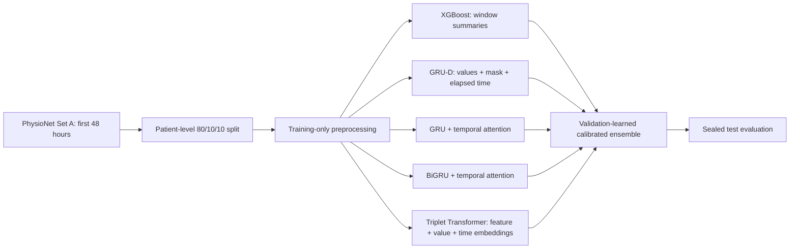
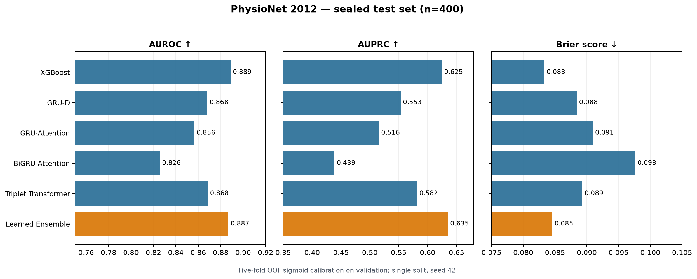
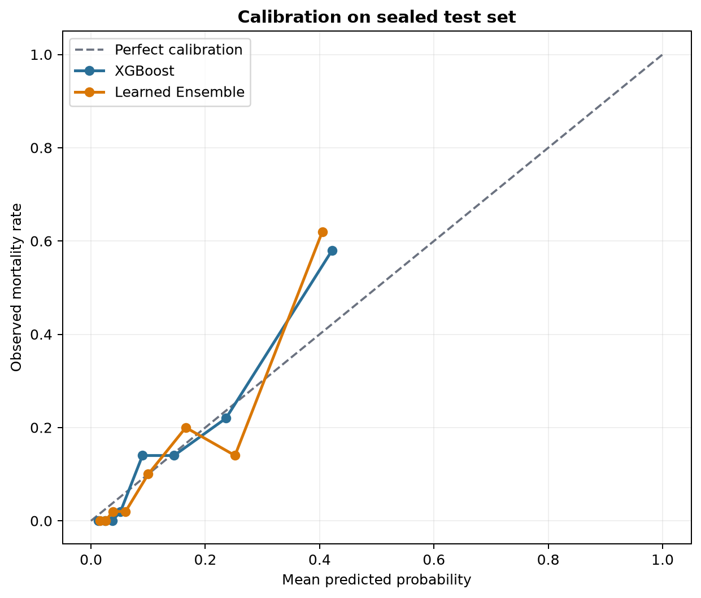
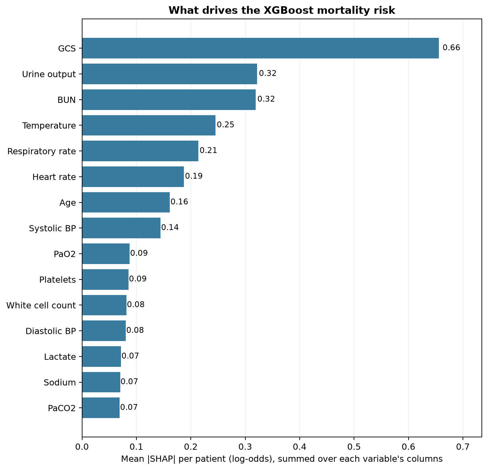
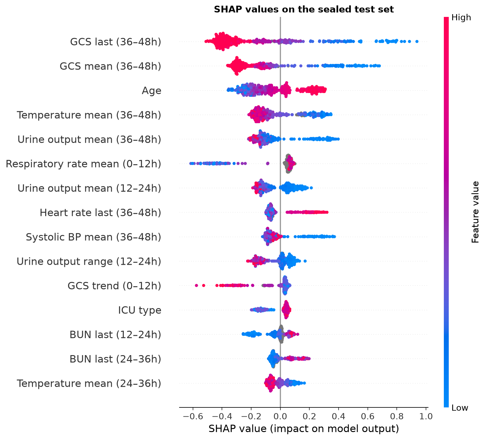
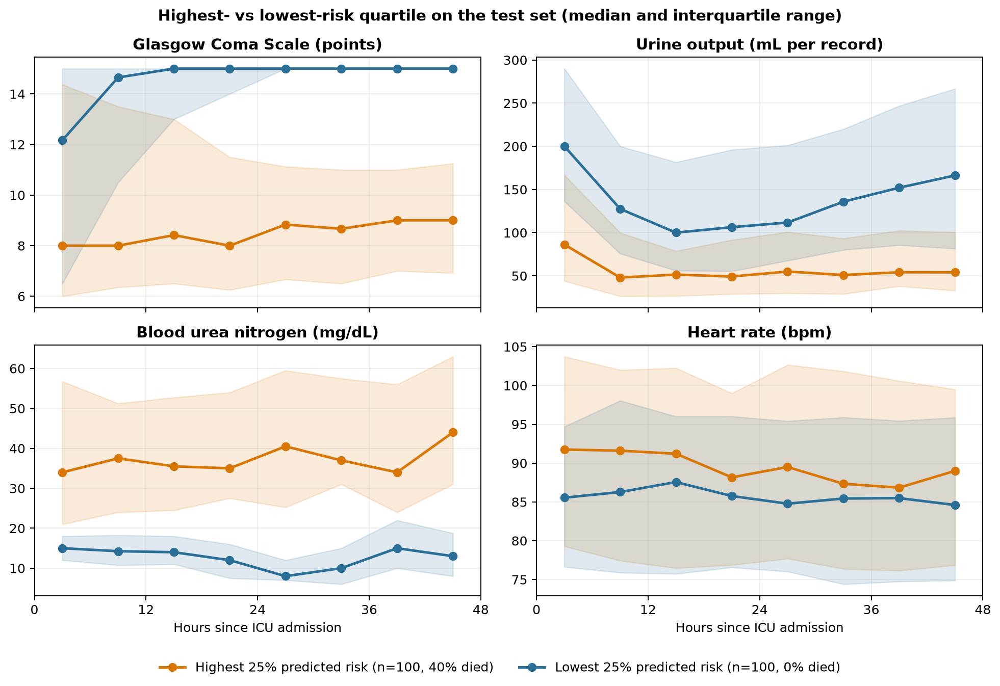
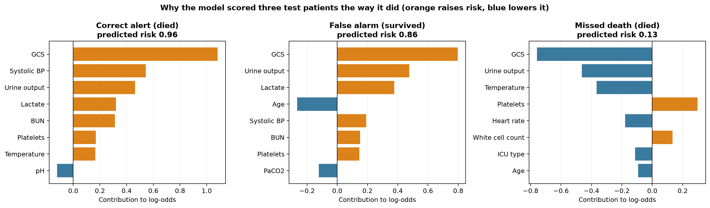
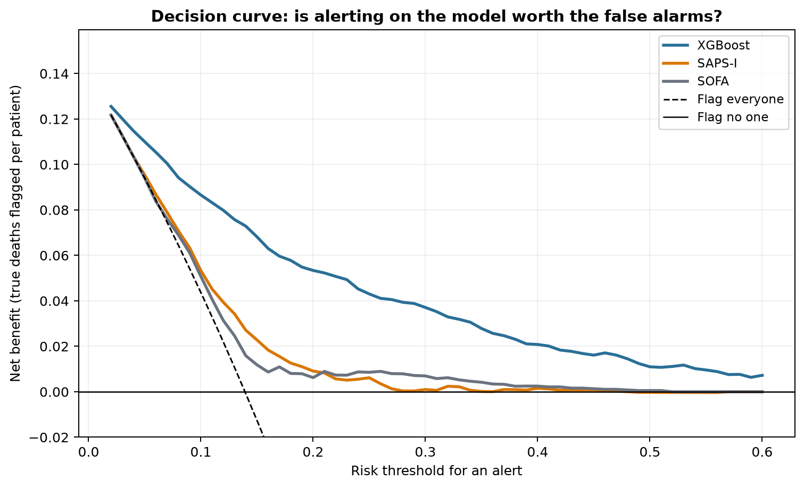

# ICU Mortality Risk Prediction

A leakage-safe benchmark for predicting in-hospital mortality from the first 48 hours of ICU observations in the [PhysioNet/Computing in Cardiology Challenge 2012](https://physionet.org/content/challenge-2012/1.0.0/). The pipeline compares a regularized tree baseline, missingness-aware recurrent networks, attention models, and an observation-triplet Transformer, then learns a calibrated probability ensemble without using test labels.

> Research and educational use only. This project is not a medical device and must not be used for clinical decisions.

## Highlights

- Patient-level stratified 80/10/10 train/validation/test split.
- Preprocessing statistics fitted on training patients only.
- Explicit modeling of informative missingness and elapsed time.
- Validation-only early stopping, calibration, threshold selection, and ensemble weighting.
- AUROC, AUPRC, Brier score, sensitivity, specificity, F1, and bootstrap uncertainty.
- Machine-readable configuration and final experiment report.
- Variable-level SHAP explanations, risk-group trajectories, and case explanations for the selected XGBoost model.
- Clinical-use analysis: comparison with SAPS-I and SOFA, decision curves, alert workload, risk-adjusted mortality (SMR funnel plot), subgroup performance, and GCS recovery.

## Architecture



## Model design

| Branch | Role | Design |
|---|---|---|
| XGBoost | Tabular baseline | Regularized shallow trees over 3h/6h/12h window summaries, with native missing-value handling. |
| GRU-D | Missingness-aware sequence model | Feature-wise input decay and hidden-state decay using values, observation masks, and elapsed time. |
| GRU-Attention | Sequential attention model | Unidirectional GRU with learned temporal pooling. |
| BiGRU-Attention | Full-window representation | Bidirectional context over the completed 48-hour observation window. |
| Triplet Transformer | Sparse observation model | STraTS-inspired feature, continuous-value, and continuous-time embeddings without creating imputed observation tokens. |

The Transformer is intentionally compact because Set A contains 4,000 labeled stays. The implementation performs supervised mortality prediction and does not claim self-supervised pretraining.

## Installation and data

```bash
python -m venv .venv
source .venv/bin/activate
python -m pip install --upgrade pip
python -m pip install '.[train,dev]'

python scripts/download_physionet.py --output-dir data/raw
```

On macOS, the XGBoost wheel may require OpenMP:

```bash
brew install libomp
```

Raw patient files are excluded by `.gitignore`.

## Run the benchmark

```bash
icu-mortality \
  --data-dir data/raw \
  --output-dir results/runs/benchmark_v1 \
  --models xgboost grud gru_attention bigru_attention triplet_transformer
```

For a short pipeline check:

```bash
icu-mortality \
  --data-dir data/raw \
  --output-dir results/runs/smoke \
  --models xgboost grud \
  --limit 400 --epochs 3 --patience 2
```

Long neural runs can be trained separately and combined without retraining:

```bash
python scripts/combine_runs.py \
  results/runs/xgboost \
  results/runs/grud \
  results/runs/gru_attention \
  results/runs/bigru_attention \
  results/runs/triplet_transformer \
  --output-dir results/runs/final_ensemble
```

Each complete run writes a patient split manifest, validation/test predictions, training records, and a JSON report.

To explain the selected XGBoost model (refits it with the benchmark seed, split, and 12h window):

```bash
python scripts/explain_xgboost.py --data-dir data/raw --output-dir results/interpretation
```

To run the clinical-use analysis (5-fold out-of-fold risk for all 4,000 patients):

```bash
python scripts/clinical_analysis.py --data-dir data/raw --output-dir results/clinical
```

## Evaluation protocol

1. The sealed test split is never used for preprocessing, model selection, early stopping, calibration, threshold selection, or ensemble weighting.
2. XGBoost window length and neural checkpoints are selected by validation AUPRC.
3. Operating thresholds are selected on validation predictions to reach at least 0.80 sensitivity.
4. Five-fold OOF sigmoid calibration aligns validation probability scales; calibrators are refitted on the full validation set and applied unchanged to test probabilities.
5. Ensemble weights are non-negative, sum to one, and minimize validation log loss.

See the [experiment protocol](docs/EXPERIMENT_PROTOCOL.md), [model rationale](docs/MODEL_SELECTION.md), [model card](docs/MODEL_CARD.md), and [clinical analysis](docs/CLINICAL_ANALYSIS.md).

## Results

The completed benchmark used all 4,000 labeled Set A records with seed 42. Metrics below are from the 400-patient sealed test split.

| Model | AUROC | AUPRC | Brier | Sensitivity | Specificity |
|---|---:|---:|---:|---:|---:|
| XGBoost (selected 12h) | **0.8888** | 0.6247 | **0.0833** | 0.8364 | **0.7420** |
| GRU-D | 0.8681 | 0.5534 | 0.0884 | 0.8000 | 0.7159 |
| GRU-Attention | 0.8565 | 0.5156 | 0.0909 | **0.9091** | 0.6841 |
| BiGRU-Attention | 0.8257 | 0.4387 | 0.0976 | 0.8909 | 0.6290 |
| Triplet Transformer | 0.8685 | 0.5817 | 0.0893 | 0.8545 | 0.7304 |
| Calibrated ensemble | 0.8868 | **0.6352** | 0.0846 | 0.8545 | 0.7130 |

The validation optimizer assigned weights of 0.4015 to XGBoost, 0.2613 to GRU-D, and 0.3373 to GRU-Attention. BiGRU-Attention and the Triplet Transformer received zero weight because they did not further reduce validation log loss after the other predictions were included.

Compared with XGBoost, the ensemble increased test AUPRC by 0.0105 and sensitivity by 0.0182, while AUROC decreased by 0.0020 and Brier score increased by 0.0013. The paired-bootstrap 95% interval for the AUPRC difference was `[-0.0535, 0.0712]`, so the observed difference is not statistically decisive. This is a single-split benchmark without external clinical validation.





The machine-readable metrics and limitations are in [`results/final_benchmark/report.json`](results/final_benchmark/report.json).

## Interpretation

`scripts/explain_xgboost.py` refits the selected 12h XGBoost with the benchmark seed and split. The refit reproduces the benchmark exactly (test AUROC 0.8888, AUPRC 0.6247). Contributions come from XGBoost's native TreeSHAP at the early-stopped iteration. Each clinical variable appears in many window and summary columns, so its contributions are summed per patient. Because SHAP values are additive, the summed value is still an exact share of the model's log-odds.

**What drives the risk.** GCS is the strongest driver (mean |SHAP| 0.66 log-odds). Urine output (0.32), BUN (0.32), temperature (0.25), respiratory rate (0.21), heart rate (0.19), age (0.16) and systolic blood pressure (0.14) follow.



**Direction of each effect.** In the last 12 hours, low GCS, low urine output, lower temperature and lower systolic blood pressure all raise predicted risk, as do a higher heart rate and older age. A rising GCS over the first 12 hours lowers it. Grey points are windows without a measurement.



**Risk-group trajectories.** The test quartile with the highest predicted risk had 100 patients, of whom 40% died. In that quartile, median GCS stayed at 8–9 points for the full 48 hours. The lowest-risk quartile also had 100 patients, and none died; its median GCS reached 15 within 12 hours. After the first six hours, median urine output per record was about 50 mL in the high-risk quartile and 100–170 mL in the low-risk quartile. Median BUN was 34–44 mg/dL versus 8–15 mg/dL. Heart rate differed less: medians were 87–92 versus 85–88 bpm, with overlapping interquartile ranges.



**Case explanations.** These use the validation threshold that reaches 0.80 sensitivity (0.366):

- **Correct alert** (predicted risk 0.96, died): GCS, systolic blood pressure and urine output contributed most to the high score.
- **False alarm** (0.86, survived): GCS, urine output and lactate raised the score, while age lowered it.
- **Missed death** (0.13): GCS, urine output and temperature all lowered the score, so the model rated this patient as low risk.



The numbers behind these figures are in [`results/interpretation/interpretation.json`](results/interpretation/interpretation.json). No patient identifiers are stored.

## Clinical analysis

[`docs/CLINICAL_ANALYSIS.md`](docs/CLINICAL_ANALYSIS.md) asks what the model means for an ICU team. Every patient gets an out-of-fold risk from 5-fold cross-validation (pooled AUROC 0.844, observed/expected deaths 1.02, calibration slope 0.98). Headline findings:

- **Added value over severity scores.** On 3,733 patients with both scores, AUROC is 0.846 for the model, 0.648 for SAPS-I and 0.617 for SOFA. The paired AUROC gain over SAPS-I is +0.198 (95% CI 0.175–0.221).
- **Half the alert workload.** To catch 80% of deaths, the model raises 34 alerts per 100 patients (3.1 alerts per death found). SAPS-I needs 64 alerts (5.7 per death) and SOFA 68 (6.0 per death). The model also has the highest net benefit on the decision curve at every threshold from 0.05 to 0.60.
- **Risk-adjusted benchmarking.** Standardised mortality ratios by ICU type range from 0.82 to 1.07, and all four types sit inside the 95% funnel limits.
- **Groups to recalibrate.** The model under-predicts deaths in patients aged 80 and over (observed/expected 1.17) and in non-ventilated patients (1.25).
- **GCS recovery.** Ventilated patients who started with GCS 3–8 had 37% mortality if GCS was still 3–8 at 36–48 hours, and 4% if it had recovered to 13–15.



## Repository structure

```text
src/icu_mortality/       # data, preprocessing, models, training, metrics, ensemble, CLI
scripts/                 # data download, run combination, plotting, and model explanation
tests/                   # parsing, leakage, preprocessing, ensemble, and model-shape tests
configs/benchmark_v1.json
docs/                    # experiment protocol, model rationale, model card, and clinical analysis
results/final_benchmark/ # reviewed report and figures
results/interpretation/  # SHAP, risk-trajectory, and case-explanation figures
results/clinical/        # score comparison, decision curve, SMR funnel, subgroup, and GCS figures
```

## Data attribution

The downloader retrieves public Set A and `Outcomes-a.txt` from PhysioNet. The dataset is distributed under the [Open Data Commons Attribution License v1.0](https://physionet.org/content/challenge-2012/view-license/1.0.0/). Patient-level data are not included in this repository.

## References

- Che et al., [Recurrent Neural Networks for Multivariate Time Series with Missing Values](https://www.nature.com/articles/s41598-018-24271-9), *Scientific Reports*, 2018.
- Tipirneni & Reddy, [Self-Supervised Transformer for Sparse and Irregularly Sampled Multivariate Clinical Time-Series](https://arxiv.org/abs/2107.14293), KDD 2022.
- Choi et al., [RETAIN: An Interpretable Predictive Model for Healthcare using Reverse Time Attention Mechanism](https://arxiv.org/abs/1608.05745), NeurIPS 2016.
- Chen & Guestrin, [XGBoost: A Scalable Tree Boosting System](https://arxiv.org/abs/1603.02754), KDD 2016.
- Lundberg et al., [From local explanations to global understanding with explainable AI for trees](https://www.nature.com/articles/s42256-019-0138-9), *Nature Machine Intelligence*, 2020.
- Vickers & Elkin, [Decision curve analysis: a novel method for evaluating prediction models](https://doi.org/10.1177/0272989X06295361), *Medical Decision Making*, 2006.
- Spiegelhalter, [Funnel plots for comparing institutional performance](https://doi.org/10.1002/sim.1970), *Statistics in Medicine*, 2005.
