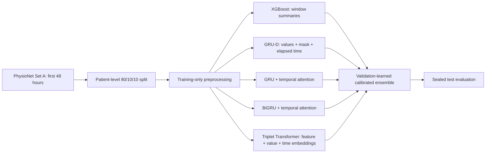

# ICU Mortality Risk Prediction

A leakage-safe benchmark for predicting in-hospital mortality from the first 48 hours of ICU observations in the [PhysioNet/Computing in Cardiology Challenge 2012](https://physionet.org/content/challenge-2012/1.0.0/). The pipeline compares a regularized tree baseline, missingness-aware recurrent networks, attention models, and an observation-triplet Transformer, then learns a calibrated probability ensemble without using test labels.

> Research and educational use only. This project is not a medical device and must not be used for clinical decisions.

## Highlights

- Patient-level stratified 80/10/10 train/validation/test split.
- Preprocessing statistics fitted on training patients only.
- Explicit modeling of informative missingness and elapsed time.
- Validation-only early stopping, calibration, threshold selection, and ensemble weighting.
- AUROC, AUPRC, Brier score, sensitivity, specificity, F1, and bootstrap uncertainty.
- Machine-readable configuration and final experiment report.

## Architecture



## Model design

| Branch | Role | Design |
|---|---|---|
| XGBoost | Tabular baseline | Regularized shallow trees over 3h/6h/12h window summaries, with native missing-value handling. |
| GRU-D | Missingness-aware sequence model | Feature-wise input decay and hidden-state decay using values, observation masks, and elapsed time. |
| GRU-Attention | Sequential attention model | Unidirectional GRU with learned temporal pooling. |
| BiGRU-Attention | Full-window representation | Bidirectional context over the completed 48-hour observation window. |
| Triplet Transformer | Sparse observation model | STraTS-inspired feature, continuous-value, and continuous-time embeddings without creating imputed observation tokens. |

The Transformer is intentionally compact because Set A contains 4,000 labeled stays. The implementation performs supervised mortality prediction and does not claim self-supervised pretraining.

## Installation and data

```bash
python -m venv .venv
source .venv/bin/activate
python -m pip install --upgrade pip
python -m pip install '.[train,dev]'

python scripts/download_physionet.py --output-dir data/raw
```

On macOS, the XGBoost wheel may require OpenMP:

```bash
brew install libomp
```

Raw patient files are excluded by `.gitignore`.

## Run the benchmark

```bash
icu-mortality \
  --data-dir data/raw \
  --output-dir results/runs/benchmark_v1 \
  --models xgboost grud gru_attention bigru_attention triplet_transformer
```

For a short pipeline check:

```bash
icu-mortality \
  --data-dir data/raw \
  --output-dir results/runs/smoke \
  --models xgboost grud \
  --limit 400 --epochs 3 --patience 2
```

Long neural runs can be trained separately and combined without retraining:

```bash
python scripts/combine_runs.py \
  results/runs/xgboost \
  results/runs/grud \
  results/runs/gru_attention \
  results/runs/bigru_attention \
  results/runs/triplet_transformer \
  --output-dir results/runs/final_ensemble
```

Each complete run writes a patient split manifest, validation/test predictions, training records, and a JSON report.

## Evaluation protocol

1. The sealed test split is never used for preprocessing, model selection, early stopping, calibration, threshold selection, or ensemble weighting.
2. XGBoost window length and neural checkpoints are selected by validation AUPRC.
3. Operating thresholds are selected on validation predictions to reach at least 0.80 sensitivity.
4. Five-fold OOF sigmoid calibration aligns validation probability scales; calibrators are refitted on the full validation set and applied unchanged to test probabilities.
5. Ensemble weights are non-negative, sum to one, and minimize validation log loss.

See the [experiment protocol](docs/EXPERIMENT_PROTOCOL.md), [model rationale](docs/MODEL_SELECTION.md), and [model card](docs/MODEL_CARD.md).

## Results

The completed benchmark used all 4,000 labeled Set A records with seed 42. Metrics below are from the 400-patient sealed test split.

| Model | AUROC | AUPRC | Brier | Sensitivity | Specificity |
|---|---:|---:|---:|---:|---:|
| XGBoost (selected 12h) | **0.8888** | 0.6247 | **0.0833** | 0.8364 | **0.7420** |
| GRU-D | 0.8681 | 0.5534 | 0.0884 | 0.8000 | 0.7159 |
| GRU-Attention | 0.8565 | 0.5156 | 0.0909 | **0.9091** | 0.6841 |
| BiGRU-Attention | 0.8257 | 0.4387 | 0.0976 | 0.8909 | 0.6290 |
| Triplet Transformer | 0.8685 | 0.5817 | 0.0893 | 0.8545 | 0.7304 |
| Calibrated ensemble | 0.8868 | **0.6352** | 0.0846 | 0.8545 | 0.7130 |

The validation optimizer assigned weights of 0.4015 to XGBoost, 0.2613 to GRU-D, and 0.3373 to GRU-Attention. BiGRU-Attention and the Triplet Transformer received zero weight because they did not further reduce validation log loss after the other predictions were included.

Compared with XGBoost, the ensemble increased test AUPRC by 0.0105 and sensitivity by 0.0182, while AUROC decreased by 0.0020 and Brier score increased by 0.0013. The paired-bootstrap 95% interval for the AUPRC difference was `[-0.0535, 0.0712]`, so the observed difference is not statistically decisive. This is a single-split benchmark without external clinical validation.


The machine-readable metrics and limitations are in [`results/final_benchmark/report.json`](results/final_benchmark/report.json).

## Repository structure

```text
src/icu_mortality/       # data, preprocessing, models, training, metrics, ensemble, CLI
scripts/                 # data download, run combination, and plotting utilities
tests/                   # parsing, leakage, preprocessing, ensemble, and model-shape tests
configs/benchmark_v1.json
docs/                    # experiment protocol, model rationale, and model card
results/final_benchmark/ # reviewed report and figures
```

## Data attribution

The downloader retrieves public Set A and `Outcomes-a.txt` from PhysioNet. The dataset is distributed under the [Open Data Commons Attribution License v1.0](https://physionet.org/content/challenge-2012/view-license/1.0.0/). Patient-level data are not included in this repository.

## References

- Che et al., [Recurrent Neural Networks for Multivariate Time Series with Missing Values](https://www.nature.com/articles/s41598-018-24271-9), *Scientific Reports*, 2018.
- Tipirneni & Reddy, [Self-Supervised Transformer for Sparse and Irregularly Sampled Multivariate Clinical Time-Series](https://arxiv.org/abs/2107.14293), KDD 2022.
- Choi et al., [RETAIN: An Interpretable Predictive Model for Healthcare using Reverse Time Attention Mechanism](https://arxiv.org/abs/1608.05745), NeurIPS 2016.
- Chen & Guestrin, [XGBoost: A Scalable Tree Boosting System](https://arxiv.org/abs/1603.02754), KDD 2016.
