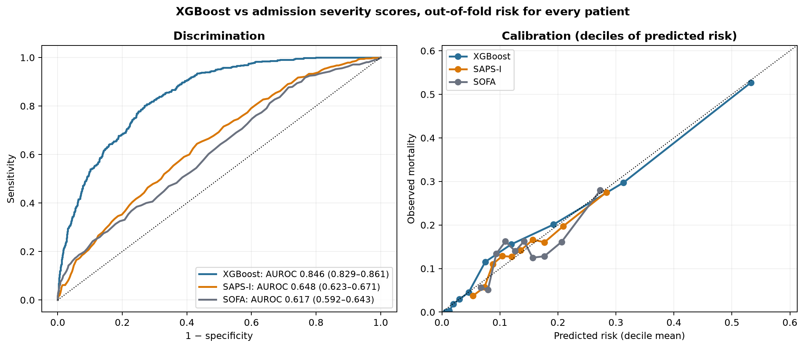
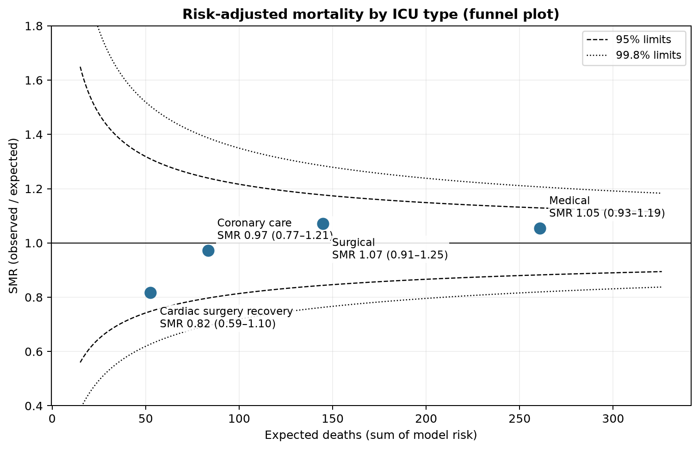
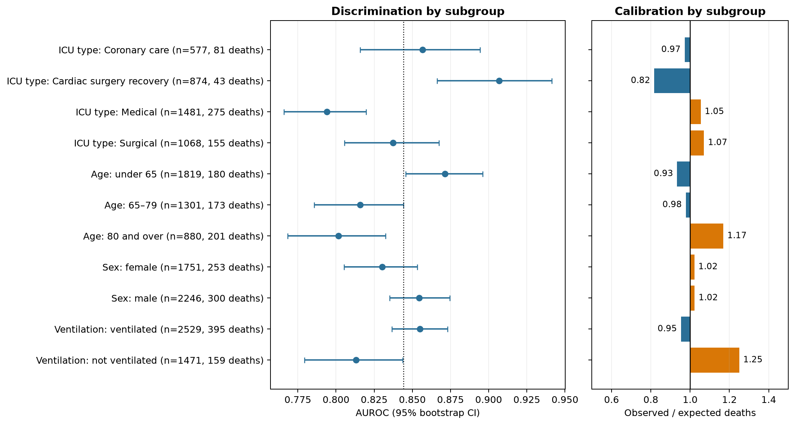
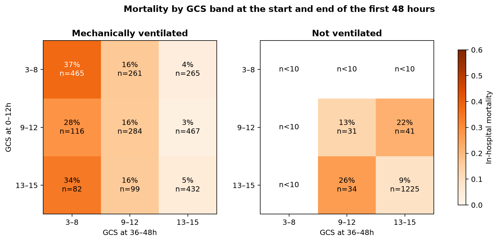

# Clinical analysis: from a risk score to clinical use

The [interpretation section](../README.md#interpretation) shows *what* drives the XGBoost risk: GCS, urine output, BUN, temperature, heart rate, systolic blood pressure and age. These are largely the variables of established ICU severity scores such as SAPS II. This report asks what that means for an ICU team:

1. Does the model add anything to the severity scores already supplied with the data (SAPS-I and SOFA)?
2. If it drives an alert, how many alerts would clinicians receive?
3. Can it support quality improvement by comparing units on risk-adjusted mortality?
4. Does it perform equally well across patient groups?
5. Is a low GCS itself the warning sign, or does the GCS trend over the first 48 hours matter more?

Every number below comes from [`results/clinical/clinical_analysis.json`](../results/clinical/clinical_analysis.json), produced by [`scripts/clinical_analysis.py`](../scripts/clinical_analysis.py).

## Design

- **Patients.** All 4,000 labelled Set A stays (554 in-hospital deaths, 13.9%).
- **Out-of-fold risk for every patient.** The analysis uses stratified 5-fold cross-validation. In each fold:
  - XGBoost (12h window summaries) is trained on seven-eighths of the other four folds;
  - it is early-stopped and Platt-calibrated on the remaining eighth;
  - it then predicts the held-out fold.

  No patient is ever scored by a model that saw them. This analysis reuses all patients, so its pooled AUROC (0.844) is not the same number as the single sealed-test AUROC in the benchmark (0.889).
- **Comparators.** SAPS-I and SOFA come from `Outcomes-a.txt`, where −1 marks a missing score. Each score is converted to a probability by logistic regression fitted on the same training folds. Score comparisons use the 3,733 patients with both scores, of whom 520 died.
- **Uncertainty.** 95% intervals come from 2,000 outcome-stratified bootstrap resamples. Model-versus-score differences use paired resamples.

## 1. Added value over admission severity scores

| Risk estimate | AUROC (95% CI) | AUPRC (95% CI) | Brier score | Observed / expected deaths | Calibration slope |
|---|---|---|---|---:|---:|
| **XGBoost** | **0.846 (0.829–0.861)** | **0.481 (0.443–0.522)** | **0.093** | 1.03 | 0.98 |
| SAPS-I | 0.648 (0.623–0.671) | 0.228 (0.207–0.257) | 0.116 | 1.00 | 0.99 |
| SOFA | 0.617 (0.592–0.643) | 0.251 (0.223–0.283) | 0.116 | 0.98 | 0.96 |

Paired differences:

- **XGBoost vs SAPS-I**: AUROC +0.198 (0.175–0.221); AUPRC +0.252 (0.212–0.292).
- **XGBoost vs SOFA**: AUROC +0.229 (0.205–0.252); AUPRC +0.229 (0.192–0.269).

All three are well calibrated. The difference is in discrimination: the model separates patients who die from those who survive much better.

This is expected. SAPS-I and SOFA, as supplied with the data, each summarise a stay as one number. The model instead reads how 34 measurements evolve over 48 hours.



## 2. Is alerting on the model worth the false alarms?

**Decision curve.** Net benefit counts correctly flagged deaths per patient, minus false alarms weighted by the chosen risk threshold.

- From a threshold of 0.05 to 0.60, XGBoost has higher net benefit than SAPS-I, SOFA, flagging everyone, and flagging no one.
- At a 10% threshold, XGBoost's net benefit is 0.087. SAPS-I reaches 0.053 and flagging everyone 0.044. That gap is about 3.3 extra deaths correctly flagged per 100 patients, at no extra cost in false alarms.


**Alert workload at the same sensitivity.** To catch 80% of deaths:

| Alert based on | Alerts per 100 patients | Positive predictive value | Alerts per death found |
|---|---:|---:|---:|
| **XGBoost** | **34** | **33%** | **3.1** |
| SAPS-I | 64 | 18% | 5.7 |
| SOFA | 68 | 17% | 6.0 |

The model needs about half as many alerts as either score to find the same share of deaths. That directly reduces alert fatigue.

XGBoost workload at fixed thresholds, across all 4,000 patients:

| Threshold | Alerts per 100 patients | Sensitivity | PPV | Alerts per death found |
|---:|---:|---:|---:|---:|
| 0.10 | 38.6 | 84% | 30% | 3.3 |
| 0.20 | 24.0 | 65% | 37% | 2.7 |
| 0.30 | 15.8 | 52% | 46% | 2.2 |
| 0.40 | 10.0 | 38% | 52% | 1.9 |
| 0.50 | 5.5 | 24% | 60% | 1.7 |

A team can choose its operating point from this table. For example, a threshold of 0.20 flags about a quarter of admissions and finds two-thirds of deaths. Roughly 1 in 3 flagged patients dies.

## 3. Risk-adjusted mortality for quality improvement

The standardised mortality ratio (SMR) for each ICU type is observed deaths divided by expected deaths, where expected deaths are the sum of model risks. Intervals are exact Poisson. The funnel plot shows whether a unit falls outside what chance alone would produce for its size.

| ICU type | Patients | Observed deaths | Expected deaths | SMR (95% CI) |
|---|---:|---:|---:|---|
| Coronary care | 577 | 81 | 83.3 | 0.97 (0.77–1.21) |
| Cardiac surgery recovery | 874 | 43 | 52.6 | 0.82 (0.59–1.10) |
| Medical | 1,481 | 275 | 260.8 | 1.05 (0.93–1.19) |
| Surgical | 1,068 | 155 | 144.8 | 1.07 (0.91–1.25) |

All four units sit inside the 95% control limits, so no unit has more deaths than its case mix predicts. Cardiac surgery recovery has the lowest ratio (0.82), but its interval still includes 1.

The same method can be applied to wards, months or hospitals. It compares their outcomes fairly after accounting for how sick their patients were.



## 4. Performance across patient groups

| Group | Patients | Deaths | AUROC (95% CI) | Observed / expected |
|---|---:|---:|---|---:|
| Coronary care | 577 | 81 | 0.857 (0.816–0.894) | 0.97 |
| Cardiac surgery recovery | 874 | 43 | 0.907 (0.866–0.941) | 0.82 |
| Medical ICU | 1,481 | 275 | 0.794 (0.766–0.820) | 1.05 |
| Surgical ICU | 1,068 | 155 | 0.837 (0.805–0.867) | 1.07 |
| Age under 65 | 1,819 | 180 | 0.871 (0.846–0.896) | 0.93 |
| Age 65–79 | 1,301 | 173 | 0.816 (0.786–0.844) | 0.98 |
| Age 80 and over | 880 | 201 | 0.802 (0.768–0.832) | 1.17 |
| Female | 1,751 | 253 | 0.830 (0.805–0.853) | 1.02 |
| Male | 2,246 | 300 | 0.854 (0.835–0.875) | 1.02 |
| Mechanically ventilated | 2,529 | 395 | 0.855 (0.837–0.873) | 0.95 |
| Not ventilated | 1,471 | 159 | 0.813 (0.779–0.844) | 1.25 |

**Discrimination.** It is strongest after cardiac surgery (0.91) and weakest in the medical ICU (0.79), where patients have more varied diagnoses. Women and men are similar.

**Calibration.** It holds for most groups, with two exceptions where the model under-predicts deaths:

- patients aged 80 and over (17% more deaths than predicted);
- patients who were not ventilated (25% more deaths than predicted).

These two groups should be recalibrated before the risk is used for decisions in them.



## 5. GCS: the trend matters more than the admission value

GCS was grouped into three bands: severe (3–8), moderate (9–12) and mild or normal (13–15). The analysis compares the last recorded GCS in the first 12 hours with the last recorded GCS at 36–48 hours, for the 3,829 patients with both. Mechanical ventilation is recorded in the data, but sedation is not, so ventilation is used as a proxy for patients likely to be sedated.

Among ventilated patients who started in the 3–8 band:

| GCS at 36–48h | Patients | In-hospital mortality |
|---|---:|---:|
| Still 3–8 | 465 | **37%** |
| Improved to 9–12 | 261 | 16% |
| Recovered to 13–15 | 265 | **4%** |

The starting value is the same in all three rows; the outcome depends on where the patient ends up. Among ventilated patients, whatever their starting GCS:

- ending at 3–8 carried 28–37% mortality;
- ending at 13–15 carried 3–5%.

A low GCS soon after admission is common in ventilated patients and often reflects sedation. A GCS that is still low at two days is the real warning sign. This matches the model, whose strongest single inputs are the last and mean GCS in the 36–48h window.

Most non-ventilated patients (1,225) stayed in the 13–15 band, and their mortality was 9%. Too few non-ventilated patients fell in the other cells to read a pattern.



## What this means for an ICU team

- **Re-check consciousness at 48 hours, not just on admission.** In ventilated patients, a GCS that has not recovered by 36–48 hours identifies a group with roughly ten times the mortality of those who recover (37% vs 4%).
- **Use the model to reduce alert burden.** At the same sensitivity, alerts driven by the 48-hour trajectory need about half the workload of alerts driven by a single severity score.
- **Benchmark with risk adjustment.** SMRs and funnel plots let units be compared fairly. In this cohort, no ICU type has excess deaths after case-mix adjustment.
- **Check groups before deployment.** Recalibrate for patients aged 80 and over and for non-ventilated patients, where deaths are under-predicted.

## Limitations

- The cohort is a single public dataset (PhysioNet 2012 Set A, four ICU types), and there is no external validation.
- SAPS-I and SOFA are compared as supplied, as single summary scores. They were not recomputed over the same 48-hour window.
- The SMR analysis uses expected risks from a model developed on these same units. It demonstrates the method; it does not audit real units.
- Results are associations in observational data and do not show that changing any measurement changes outcomes.
- Sedation is not recorded, so mechanical ventilation stands in for it.

## Reproduce

```bash
python scripts/download_physionet.py --output-dir data/raw
python scripts/clinical_analysis.py --data-dir data/raw --output-dir results/clinical
```

The run takes a few minutes on a laptop (five XGBoost fits plus bootstrap resampling).
